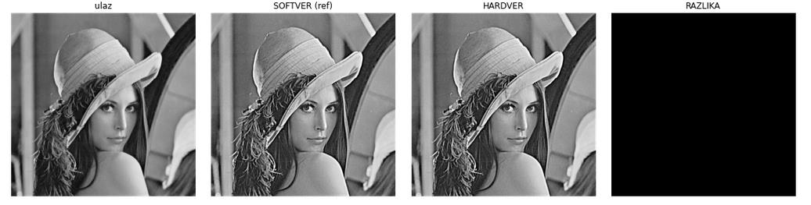
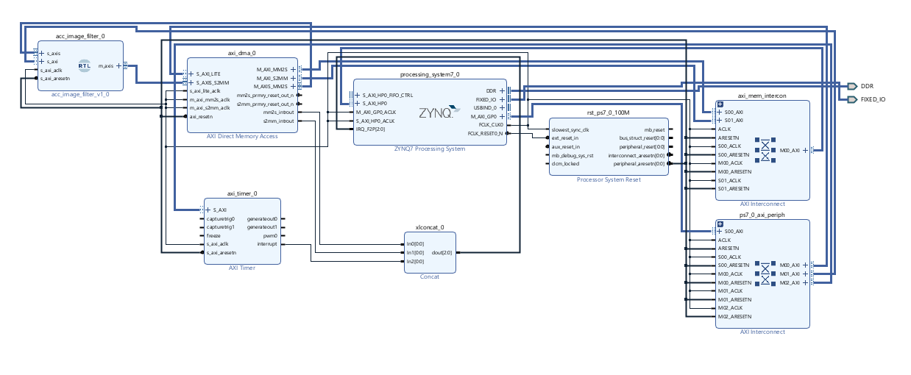
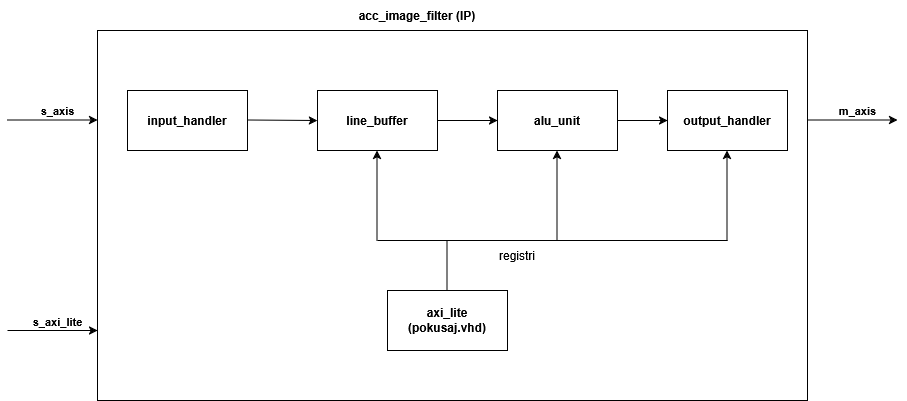
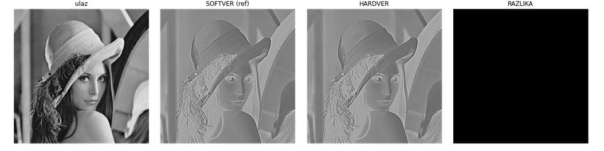

# FPGA Image Filter Accelerator (Zynq-7000)

Hardware accelerator for **2D image convolution** (linear, spatially invariant filters up to **9×9**), written in VHDL and integrated into a complete **Zynq-7000 SoC** system on the PYNQ-Z2 board.
The ARM Cortex-A9 configures the accelerator over **AXI4-Lite** and streams the image through an **AXI DMA** (AXI4-Stream, interrupt driven).
On real hardware the result is **bit-exact** with the software reference, with a speedup of up to **~530×** over the same filter running on the ARM core.

University project for the course *Digital VLSI Systems*, School of Electrical Engineering (2025/26).


<sub>Sharpen filter 9×9 on a 512×512 image, measured on the board. From left: input · software reference · hardware result · difference (all zero = bit-exact).</sub>

## System



| Block | Purpose |
|---|---|
| Zynq PS (Cortex-A9) | runs the bare-metal application, configures the accelerator |
| AXI DMA | moves pixels DDR → accelerator (8-bit stream) and results back to DDR (16-bit stream) |
| `acc_image_filter` | custom VHDL accelerator (this project) |
| AXI Timer | measures software and hardware execution time |
| Concat → IRQ_F2P | DMA completion interrupts to the processor |

## Accelerator architecture



| Module | Description |
|---|---|
| `pokusaj.vhd` | AXI4-Lite slave with the register file (control, radius, image size, scale, 81 coefficients) |
| `axis_input_handler.vhd` | receives 8-bit pixels from the DMA, with back-pressure |
| `line_buffer.vhd` | keeps the previous 8 image rows in Block RAM and outputs a whole 9-pixel vertical column per clock |
| `alu_unit.vhd` | 9-column sliding window and a **4-stage pipelined MAC**: 81 parallel multiplications → 9 partial sums → total → scaling and saturation |
| `axis_output_handler.vhd` | packs results into output words and generates `TLAST` at the end of the frame |

Key properties:
- **Run-time configurable:** radius 1–4 (3×3 … 9×9), 81 signed 16-bit fixed-point coefficients and a scale factor.
- **Two output modes:** 8-bit unsigned with saturation (blur, sharpen) or 16-bit signed (edge detection, LoG, Sobel).
- **Fully pipelined:** about one output pixel per clock at **100 MHz**, so processing time depends only on the image size, not on the filter size.

### Register map (base `0x4000_0000`)

| Offset | Register | Description |
|---|---|---|
| `0x00` | `CTRL` | bit 0 = output mode (0: uint8, 1: int16) |
| `0x04` | `RADIUS` | filter radius R = 1…4 |
| `0x08` | `IMG_W` | image width (max 512) |
| `0x0C` | `IMG_H` | image height |
| `0x10` | `COEFF_SCALE` | scale factor (U4.12) |
| `0x14 + 4·i` | `COEFF[i]` | coefficient i = 0…80 (Q1.15), 9×9 layout, smaller kernels centred |

## Software (`sw/main.c`)

Bare-metal application (Vitis 2024.1):
- `QuantizeCoeffs`: converts floating-point filter coefficients to the fixed-point format of the hardware.
- `ImageFilterSW`: C reference using exactly the same fixed-point arithmetic, so the results can be compared bit by bit.
- `ImageFilterHW`: writes the registers, flushes or invalidates the cache, starts the S2MM and MM2S DMA transfers and waits for the interrupts.
- `CheckData`: compares SW and HW pixel by pixel. The AXI Timer measures both, and the program prints the speedup.
- Built-in filters: **Box, Gaussian, LoG, Sharpen, Sobel** and a custom kernel, selectable at run time from XSCT.

`scripts/verify_results.ipynb` prepares the input image for loading into DDR and shows input, SW, HW and the difference for any filter.

## Results

Measured on the PYNQ-Z2, 512×512 image:

| Filter | Kernel | SW (ms) | HW (ms) | Speedup |
|---|---|---:|---:|---:|
| Box | 3×3 | 295.3 | 4.37 | **68×** |
| Box | 5×5 | 771.4 | 4.36 | **177×** |
| Box | 7×7 | 1 421.2 | 4.36 | **326×** |
| Box | 9×9 | 2 296.3 | 4.35 | **528×** |
| Gaussian | 9×9 | 2 296.3 | 4.35 | **528×** |
| Sharpen | 9×9 | 2 296.4 | 4.32 | **532×** |
| LoG (16-bit output) | 9×9 | 2 299.1 | 5.33 | **431×** |

Every tested filter, radius and output mode gave a **bit-exact** match between hardware and software.


<sub>Laplacian of Gaussian 5×5 (16-bit signed output mode): input · SW · HW · difference.</sub>

**FPGA resources** (xc7z020, whole system):

| LUT | FF | DSP48 | BRAM tiles |
|---:|---:|---:|---:|
| 6 743 (12.7 %) | 7 594 (7.1 %) | 83 (37.7 %) | 3 (2.1 %) |

All timing constraints are met at **100 MHz**.

## Repository structure

```
hw/src/      VHDL sources of the accelerator
hw/sim/      testbenches (each module + full accelerator)
hw/bd/       Vivado block design
sw/          bare-metal C application (Vitis)
scripts/     Python/Jupyter: input preparation and result verification
data/        test images (Lena 128×128 and 512×512, with header)
docs/        full project report (in Serbian)
images/      figures for this README
```

The full report, with module descriptions and all test results, is in [`docs/izvestaj.pdf`](docs/izvestaj.pdf) (in Serbian).

## Tools

VHDL · Vivado 2024.1 · Vitis 2024.1 · C · Python (NumPy, Matplotlib) · Zynq-7000 (PYNQ-Z2) · AXI4-Lite · AXI4-Stream · AXI DMA
